# PakTrak

**Every card. In reach.**

[](https://github.com/Addison16/PakTrak/releases/latest)
[](LICENSE)
[](https://github.com/Addison16/PakTrak/pkgs/container/paktrak)

PakTrak is a self-hosted Magic: The Gathering collection app for your phone's browser. Lay out a page of cards and take one photo. PakTrak outlines the cards it finds, suggests a printing for each, and adds the strongest matches to your collection on its own; anything it isn't sure about waits for a quick check, and you can add a card it missed. It runs on your own server, keeps your data there, and is free and open source under the [GNU AGPL v3](LICENSE).

<table>
  <tr>
    <td width="33%">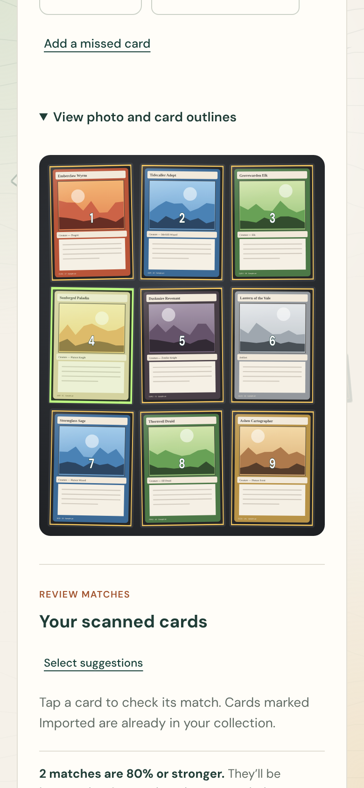</td>
    <td width="33%">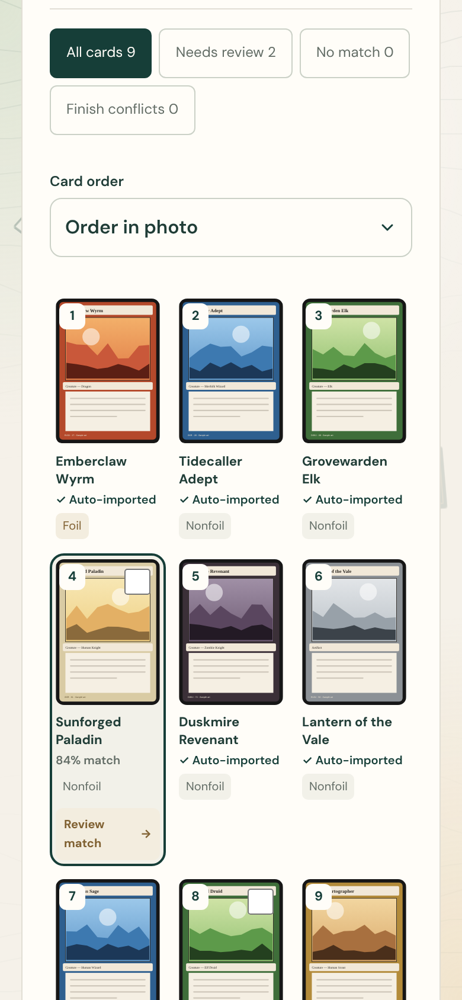</td>
    <td width="33%">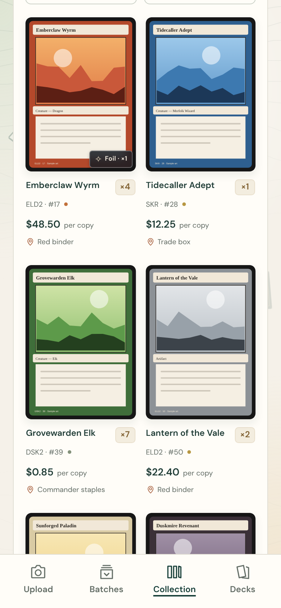</td>
  </tr>
  <tr>
    <td align="center">One photo, a whole page of cards</td>
    <td align="center">Strong matches add themselves</td>
    <td align="center">Every copy, price and binder</td>
  </tr>
  <tr>
    <td>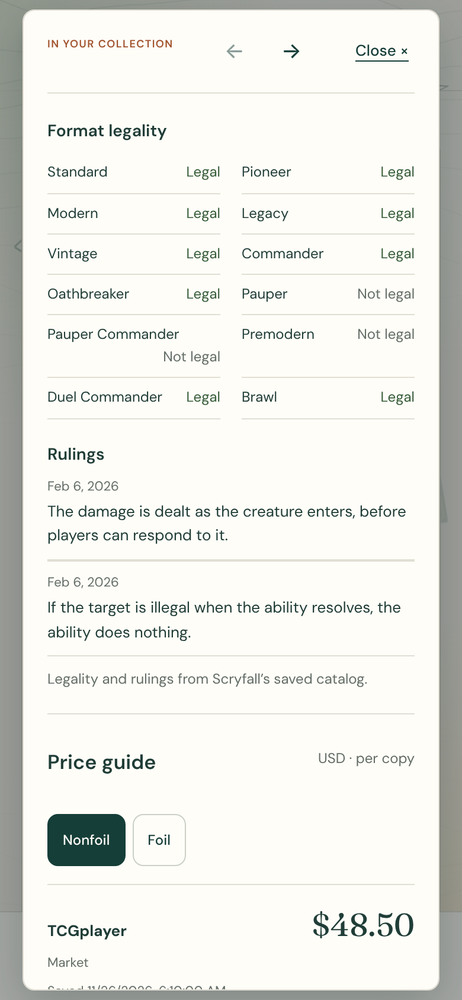</td>
    <td>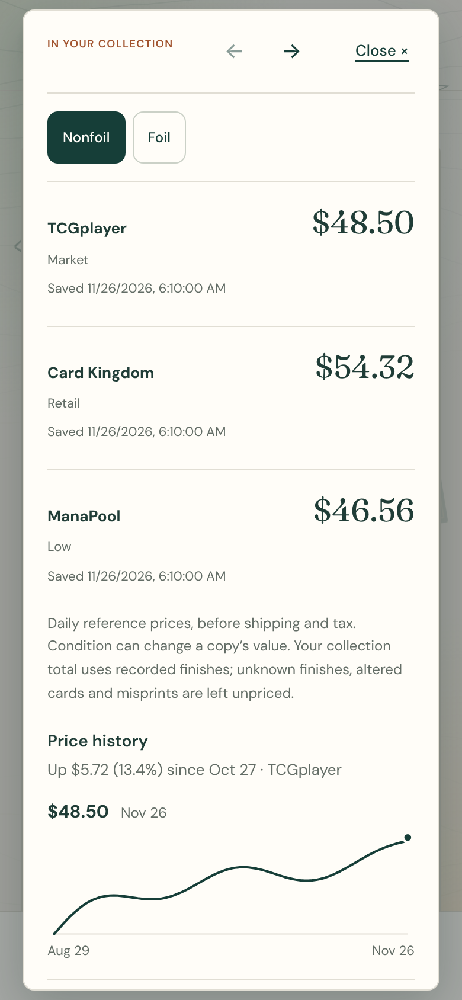</td>
    <td>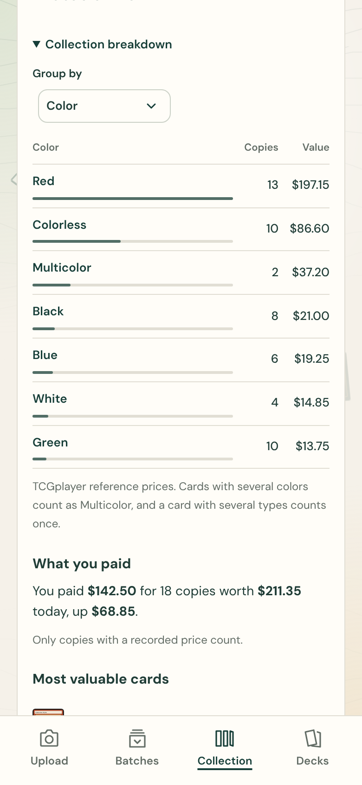</td>
  </tr>
  <tr>
    <td align="center">Legality and rulings</td>
    <td align="center">Three price sources and history</td>
    <td align="center">Where your value sits</td>
  </tr>
  <tr>
    <td>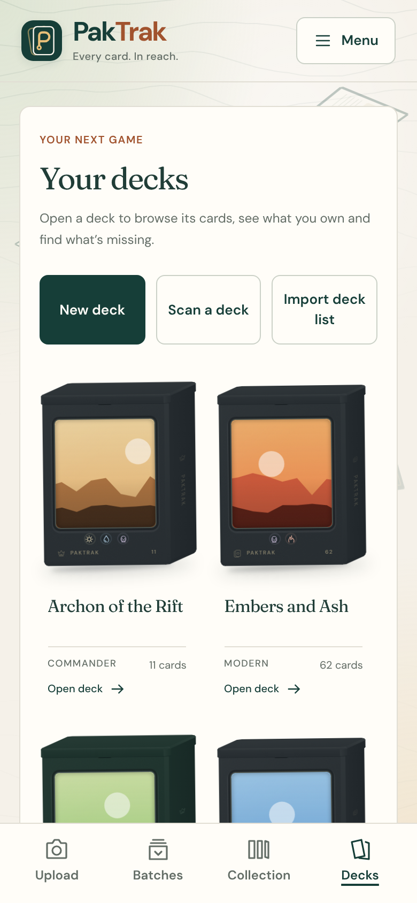</td>
    <td>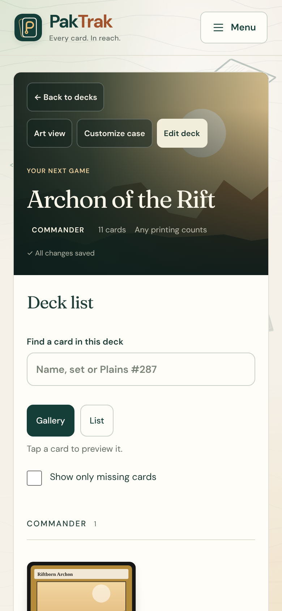</td>
    <td>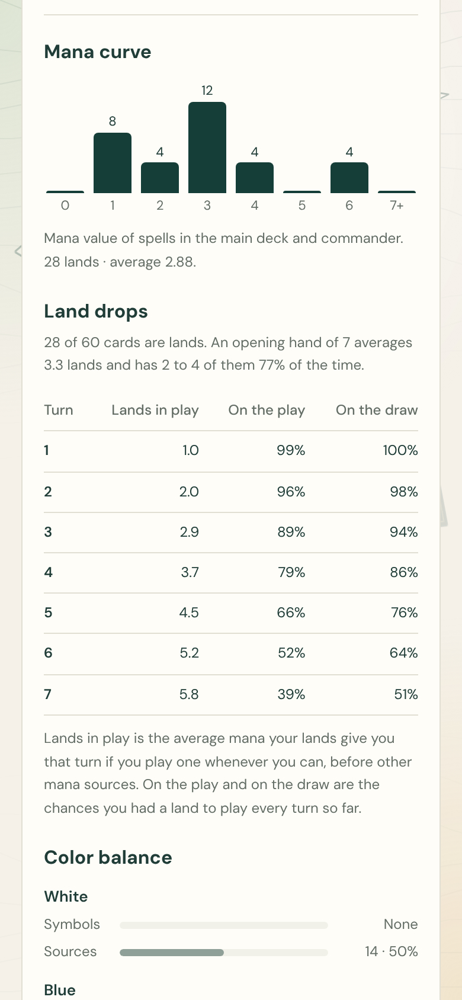</td>
  </tr>
  <tr>
    <td align="center">Decks in their own boxes</td>
    <td align="center">A page for every deck</td>
    <td align="center">Mana curve and land drop odds</td>
  </tr>
  <tr>
    <td>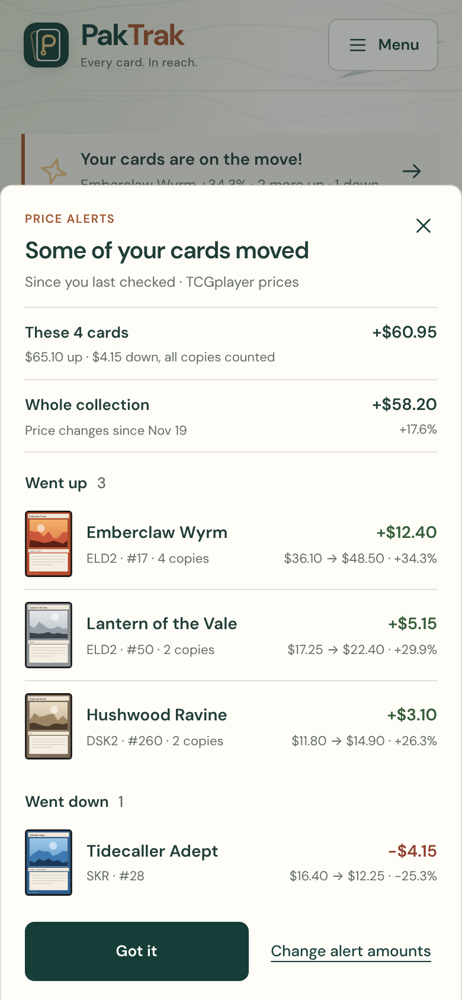</td>
    <td>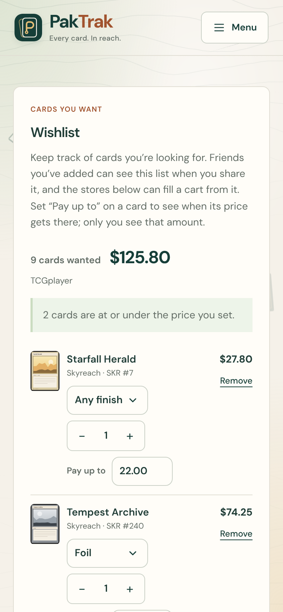</td>
    <td>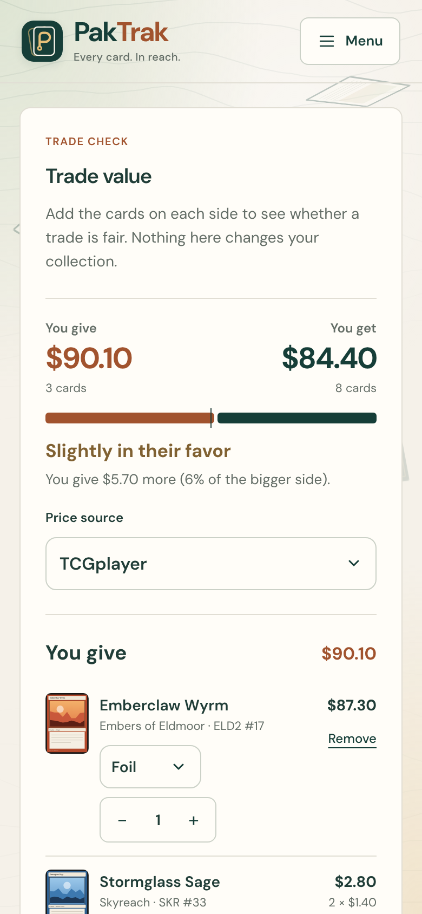</td>
  </tr>
  <tr>
    <td align="center">Alerts when your cards move</td>
    <td align="center">A wishlist that watches prices</td>
    <td align="center">Is this trade fair?</td>
  </tr>
</table>

It works just as well on a computer, with keyboard shortcuts for getting around.

<table>
  <tr>
    <td width="50%">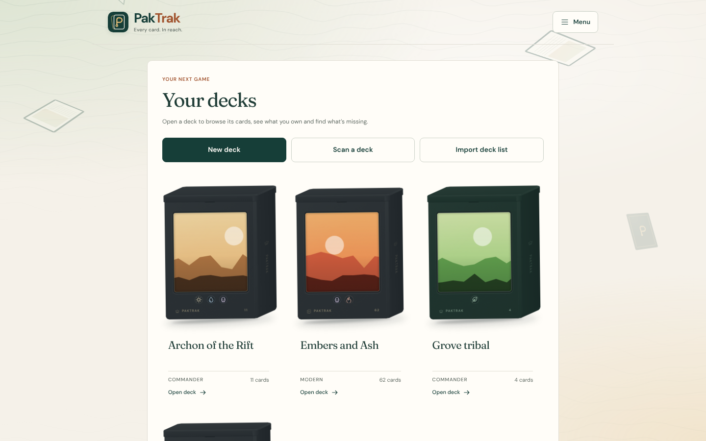</td>
    <td width="50%">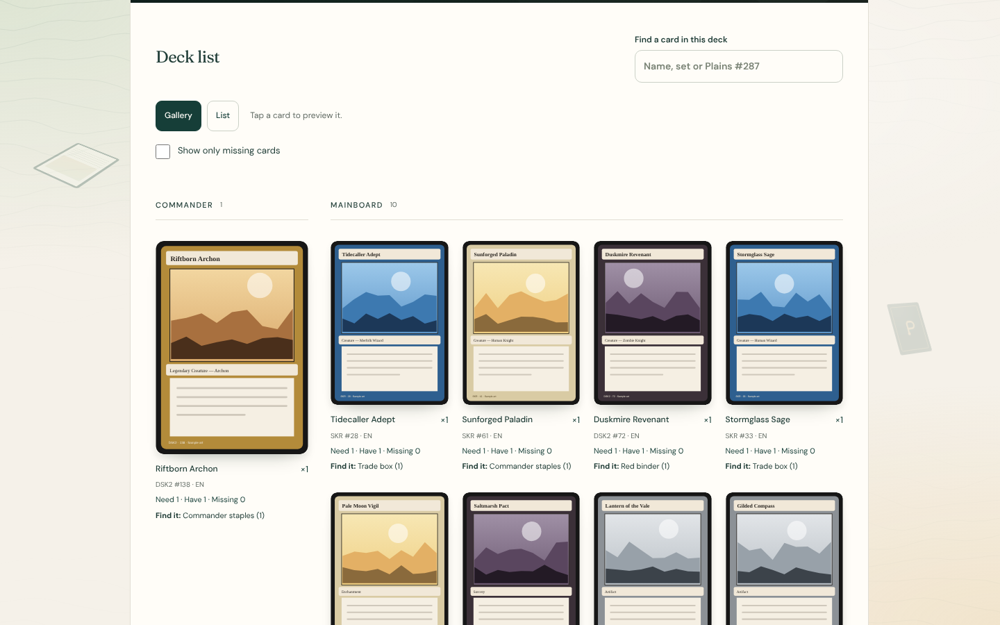</td>
  </tr>
</table>

<sub>Screenshots use made-up cards and placeholder art. Real card images come from Scryfall once your server downloads the card catalog.</sub>

## Why PakTrak

- **Scans a whole page at once.** Most card scanners read one card at a time. PakTrak takes a photo of a binder page or a table full of cards, outlines each card, reads the name, set and collector number, and compares the artwork to suggest the printing. You confirm anything it isn't sure about.
- **Built for a phone, runs on your server.** Upload a photo and put your phone away. The server keeps working, and the results are waiting when you come back.
- **Knows where your cards are.** Every copy belongs to a binder or box, so a deck list can tell you which cards you own and where to find them.
- **Private by design.** Your collection stays on your server. Friends connect with private codes, and PakTrak never shows who else has an account.

## Features

### Scanning and adding cards
- Photograph up to a page of cards with the in-app camera, the phone's own camera or a photo from your library (JPEG, HEIC, PNG, WebP and more). See [photo formats](docs/PHOTO_FORMATS.md).
- Matches above 88% strength are added automatically; the rest get a quick guided review with suggested printings, crop correction and upside-down card handling. Draw an outline by hand around a card the scan missed or outlined badly. See [scanning](docs/SCANNING.md) and [the camera](docs/CAMERA.md).
- Tap the foils in a batch to mark them, and pick the foil type (etched, galaxy, surge, fracture and the rest) from the foils that card really comes in. Scan review tells you when you already own a card.
- Undo a whole batch later without touching cards from other scans.
- **Add a card** by hand: search, pick the printing, then set finish, condition, location and how many copies.
- Import from other apps with CSV or plain text lists like `4 Lightning Bolt (M11) 146`, wishlist rows included. Big lists pick up where they left off if interrupted, and **Cancel import** stops one cleanly. See [import formats](docs/IMPORT_FORMATS.md).

### Collection
- A searchable card gallery with copy counts, filters (including foil type and your own labels), saved views, shuffle and price sorting. Swipe through cards in the order you're viewing them.
- Card details with format legality for twelve paper formats and the official rulings, saved with the daily catalog update so they work offline too.
- Binders and boxes: see where every copy lives, and move, relabel or mark cards for trade in bulk with a preview before anything changes.
- Collection value from TCGplayer, Card Kingdom or ManaPool, with a value-over-time chart and a price history for each card.
- **Collection breakdown** by color, rarity, type, set or location, your most valuable cards, and what you paid next to what they're worth today.
- Record what you paid per copy and see how far today's price is up or down.
- Price alerts on Home when your cards go up or down by an amount you choose.
- Set completion with the cost to finish a set.
- Export to CSV or text at any time.

### Decks
- Saved decks shown as customizable deck boxes with commander artwork.
- Import a deck list or scan a physical deck across several photos.
- See which cards you own, which binder they're in, and what's still missing, with a buy list, buttons for TCGplayer, Card Kingdom and ManaPool, and **Print proxies** for the cards you don't have yet.
- Deck value with notes when cards jump in price, format legality, token checklist and sample opening hands. See [decks](docs/DECKS.md).
- Deck stats: mana curve, land drop odds for turns 1 to 7 on the play and on the draw, color balance between your spells and your mana, and card types.
- Export for MTG Arena or MTGO, or every deck at once as text or CSV, and restore them all from that CSV.

### Friends and trading
- A wishlist with prices, store buttons and a **Pay up to** price on each card that tells you when it's at your price. Only you see that amount.
- Add friends with a private friend code, browse each other's collections and wishlists, see the cards each of you has marked for trade, and send trade offers. Accepting updates each person's own collection.
- Friends on other PakTrak servers: once the administrators of both servers approve a connection, people add each other with `CODE@server-address`. Servers never list each other's accounts, and trade offers stay within one server for now. See [wishlist, friends and trade offers](docs/FRIENDS.md).
- Trade value: add cards to both sides and see whether a trade is fair.
- Read-only share links for a deck or your wishlist, for people without an account. Nothing is shared until you make a link, and **Turn off link** ends it.

### Everyday use
- Works offline: view your collection and decks without a connection and queue changes until the server is back. See [using PakTrak offline](docs/OFFLINE.md).
- Accounts for everyone in the house, with an administrator who approves new members and can set scan limits. See [account controls](docs/ACCOUNTS.md).
- Daily automatic backups on the single-container install, with download and restore from the app.
- Light and dark mode, five color themes with soft backdrops and a few cards drifting behind each page, and gentle transitions between screens. **My account → Appearance → Animations** turns them down or off.
- Keyboard shortcuts on a computer: **/** to search, **G** then a letter to jump to a page, **?** to list them all.
- Loading placeholders while decks and the collection arrive, so a slow connection never looks like an empty page.
- Card data and prices update daily on the server. See [card data and pricing](docs/CARD_DATA.md).

## Install

PakTrak runs in Docker on any Linux x86-64 (amd64) server, and on ARM64 computers such as a Raspberry Pi 4 or 5 with a 64-bit system. There is no default password; the first person to open it creates the administrator account.

### Try it with one command

On any server with Docker, replace `192.168.1.50` with your server's address and run:

```sh
docker run -d --name paktrak --restart unless-stopped --stop-timeout 120 \
  -p 8095:8095 -e APP_URL=http://192.168.1.50:8095 \
  -v paktrak-data:/data ghcr.io/addison16/paktrak:latest
```

The first start takes a few minutes. When `docker logs paktrak` shows **PakTrak is running**, open the address and choose **Create administrator account**. Everything PakTrak keeps is in the `paktrak-data` volume, so you can replace the container to update:

```sh
docker pull ghcr.io/addison16/paktrak:latest
docker stop paktrak && docker rm paktrak
```

Then run the `docker run` command above again.

### Unraid or a single container

The simplest setup is the all-in-one container `ghcr.io/addison16/paktrak`, which holds the database, sign-in service, photo storage and web app. On Unraid you add it from a template and update it from the **Docker** page like any other app. Follow the [Unraid guide](docs/UNRAID.md), which also covers HTTPS, backups and moving from a Docker Compose install.

### Docker Compose

Install Git and Docker with Compose 2.18 or newer, then run:

```sh
git clone https://github.com/Addison16/PakTrak.git
cd PakTrak
sh scripts/setup.sh
sh scripts/update.sh
```

Open **http://localhost:8095** and choose **Create administrator account**. Run `sh scripts/update.sh` again whenever you want the latest release. You can also run PakTrak with only `compose.yaml` and `.env`, without Git; see [Docker Compose without Git](docs/OPERATIONS.md#docker-compose-without-git).

### Using it from your phone

Put PakTrak behind HTTPS with a hostname so your phone can use the live camera and full offline mode, then add it to your Home Screen. The [Docker and HTTPS guide](docs/OPERATIONS.md#https-and-access-from-a-phone) covers reverse proxies, hostnames, updates and [backups](docs/OPERATIONS.md#upgrades-and-backups).

## For developers

Build from source with `sh scripts/start.sh --build`. Tests run with `sh scripts/test.sh` and `sh scripts/test-browser.sh`; [validation status](docs/STATUS.md) explains what is covered. README screenshots come from `node scripts/readme-screenshots/shoot.mjs`, which runs the web app against made-up cards. See [architecture decisions](docs/ARCHITECTURE.md), the [release guide](docs/RELEASING.md), [quality of life notes](docs/QOL.md), [browser navigation](docs/NAVIGATION.md), [PakTrak's visual identity](docs/BRAND.md) and the [changelog](CHANGELOG.md). Contributions and security reports are covered by [CONTRIBUTING.md](CONTRIBUTING.md) and [SECURITY.md](SECURITY.md).

## License

PakTrak is free and open-source software under the [GNU Affero General Public License v3.0](LICENSE) (AGPL-3.0-only), with the project [notice](NOTICE). You may use, modify and share it, including commercially. Modified versions must stay under the AGPL with their source available, and if you run a modified version as a network service, you must offer its users the source. Third-party software, fonts and card data keep their own licenses; see [third-party notices](THIRD_PARTY_NOTICES.md) and [dependencies](docs/DEPENDENCIES.md).

Card data and images come from [Scryfall](https://scryfall.com/docs/api). Magic: The Gathering belongs to Wizards of the Coast. PakTrak is unofficial and is not endorsed by Wizards of the Coast or Scryfall.
